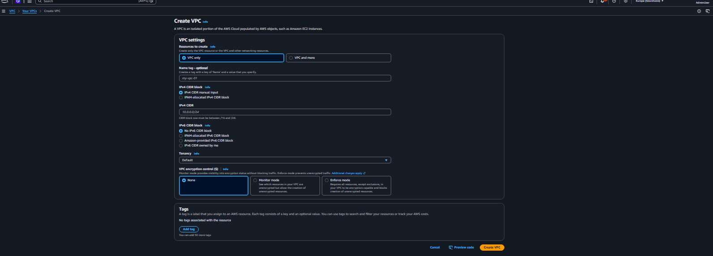

## AWS Assingment 1 -  VPC & Networking

#### Objective : Create a custom VPC with one public and one private subnet, set up the correct routing for internet access, and deploy EC2 instances across them.

### Steps
Here are the steps I take in order to achieve this :

1. Create the VPC

I am going to create a Custom VPC with 2 subnets ; 1 public and 1 private

- Keep everything the same 
- Choose the IPv4 CIDR Range ; 10.0.0.0/16

